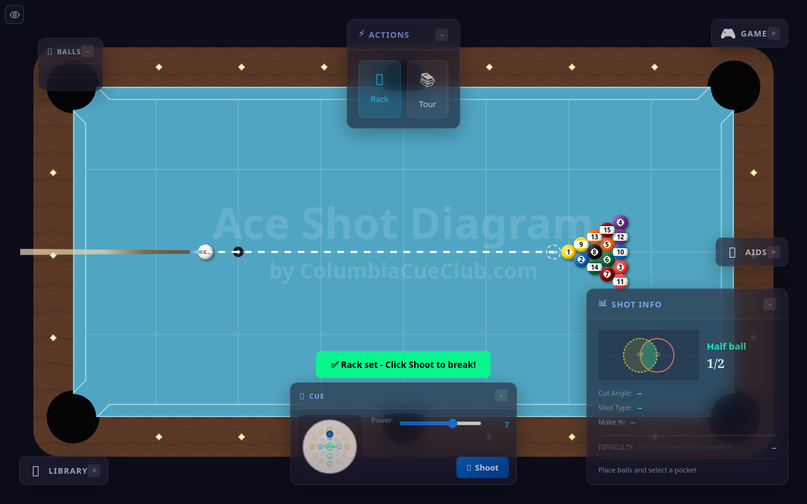
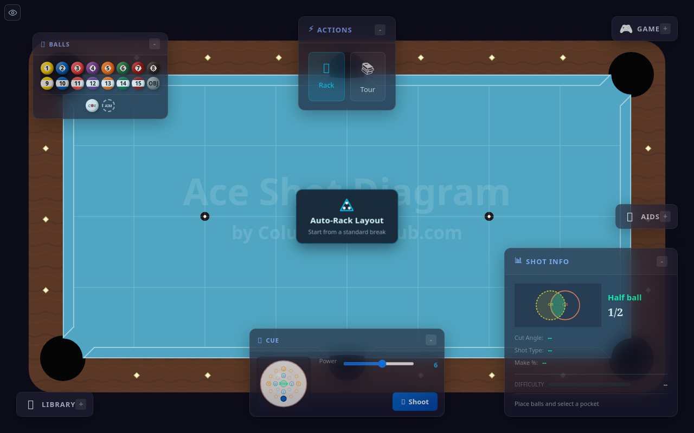
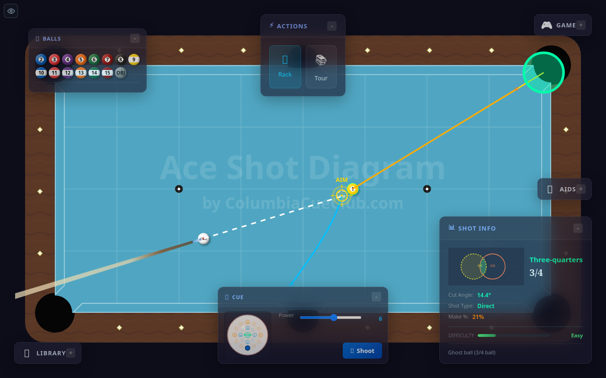
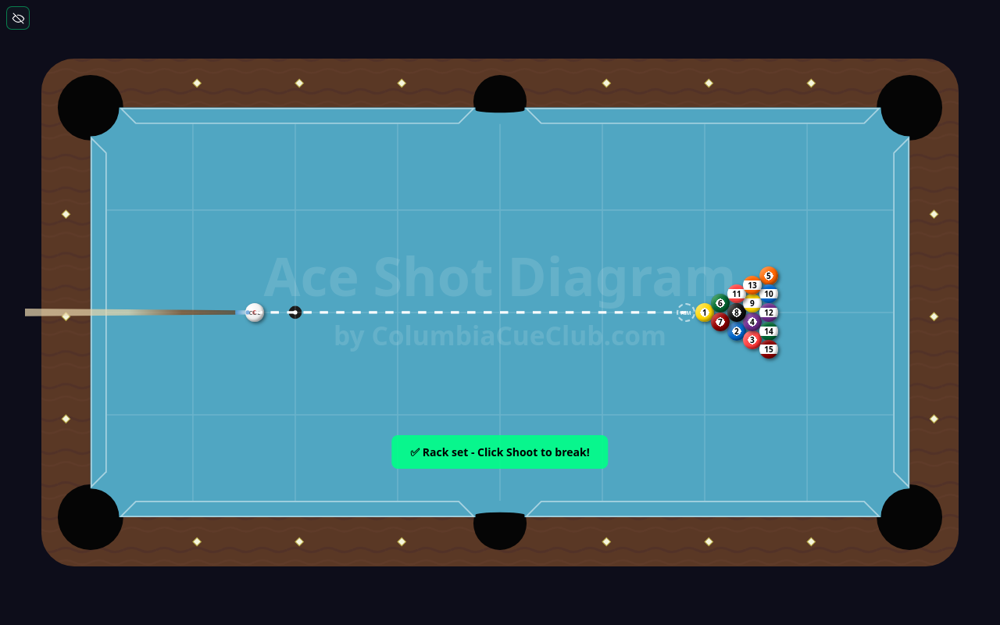
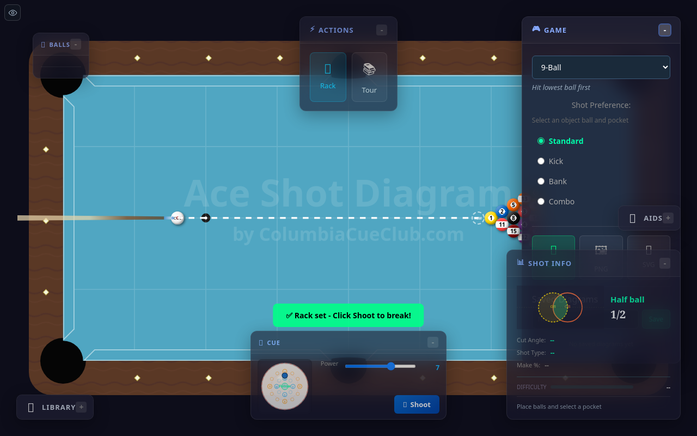
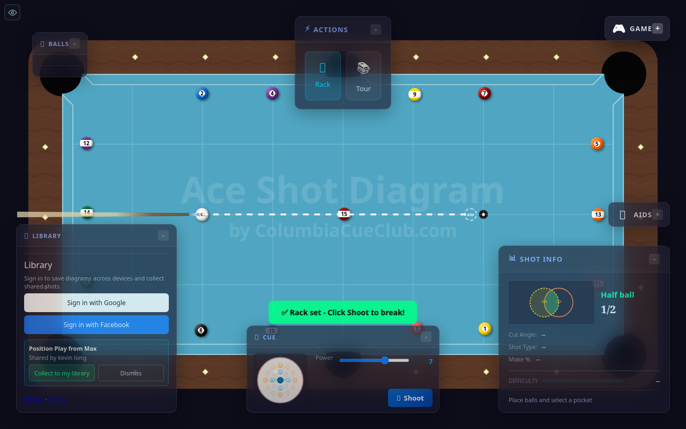
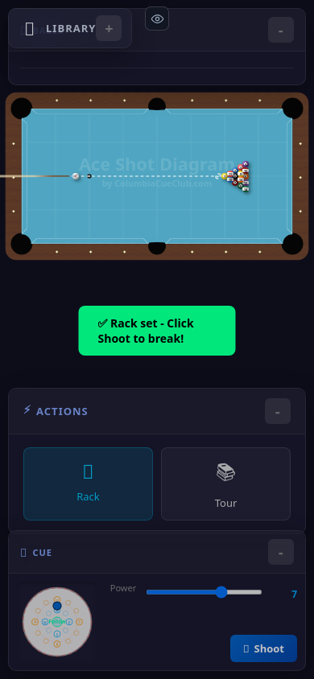

# ACE Shot Diagrams

An interactive pool/billiards shot diagramming tool with physics-based shot solving, position play aids, and multiple game mode support.



**[Live app →](https://codeonline.io/ace/)** — no install, no build;
the page carries its own physics core.

## Quick Start

1. Open the [live app](https://codeonline.io/ace/) or `index.html` in any modern browser.
2. Click an object ball, then click a pocket. The ghost ball, cue stick, aim/kick line and Shot Info update immediately.
3. Adjust english (spin) and power in the Cue palette, then use Shoot.
4. On an empty felt, click **Auto-Rack Layout**. Rack asks before clearing an existing layout.
5. Switching game mode keeps the current layout; rack explicitly when ready.
6. Use the eye at top-left (or press **H**) to hide all panels; toggle again to restore the open/minimized state.
7. Export/save from the Game palette; the Library (bottom-left) handles shared links and accounts.

The editor is still a single HTML file with no build step. Accounts and the cloud
library are optional and use a same-origin Django service (`aceweb`); guests keep
local saves and URL sharing.

## Screenshots & covered scenarios

| Overview | Empty felt |
|---|---|
|  |  |
| **Aim a shot** | **Hide all panels** |
|  |  |
| **Export and save** | **Library on a shared link** |
|  |  |
| **Mobile** | |
|  | |

| User scenario | What to expect | Playwright coverage |
|---|---|---|
| Place and select balls | Drag/drop, single-click select, preserved positions | `tests/critical-path/01-ball-placement.spec.ts` |
| Aim at a pocket | Ghost ball, cue stick, target line, cut angle, make %, difficulty | `tests/critical-path/02-pocket-selection.spec.ts`, `03-shot-calculation.spec.ts`, `tests/features/aim-consistency.spec.ts` |
| Start from an empty table | **Auto-Rack Layout** racks without a prompt | `tests/features/rack-safety.spec.ts` |
| Rack over a custom layout | Native confirmation; cancel preserves the layout | `tests/features/rack-safety.spec.ts`, `rack-start.spec.ts` |
| Switch game mode | Layout, cue, spin and power are preserved | `tests/features/rack-safety.spec.ts` |
| Hide/restore panels | Eye/H hides every panel and restores open/minimized/closed state | `tests/ui-ux/palette-minimize.spec.ts`, `rack-safety.spec.ts` |
| Export and save | PNG download, SVG download, copied share URL, local save survives reload | `tests/features/export-share.spec.ts` |
| Share and account | Public OG/image; anonymous shared view opens Library; authenticated view keeps it minimized | `tests/features/share-account.spec.ts` |
| Mobile | 390×844 layout and touch targets | `tests/features/mobile.spec.ts` |
| Shot animation and kick shots | Break/shot feedback and kick solver | `tests/features/shot-animation.spec.ts`, `tests/features/shot-types/kick-shots.spec.ts` |
| Safety zones | Snooker zone shading and best-leave marker | `tests/features/safety-zones.spec.ts` |

## Documentation & Notes

Design notes, plans, and research for the project (start with `claude.md`):

| Doc | What it covers |
|-----|----------------|
| [claude.md](claude.md) | Developer reference: architecture, coordinate system, physics, the Rust core + tooling, and gotchas |
| [PLAN.md](PLAN.md) | Five-phase physics/rendering improvement plan (sim↔solver consistency, trails, annotations, curriculum, Rust core) |
| [ROLLING_BALL_DESIGN.md](ROLLING_BALL_DESIGN.md) | Rolling-ball visualization: model, chosen treatment, and remaining polish |
| [UX_FIXES_PLAN.md](UX_FIXES_PLAN.md) | UX issues found via the Playwright walkthrough and the fixes applied |
| [FEATURE_ROADMAP.md](FEATURE_ROADMAP.md) | Planned features and explicit anti-features |
| [GAME_MODE_PLAN.md](GAME_MODE_PLAN.md) | Game-mode and combo implementation details |
| [POOL_TABLE_SVG_RESEARCH.md](POOL_TABLE_SVG_RESEARCH.md) | Research behind the pool-table SVG |
| [PLAYWRIGHT_TEST_PLAN.md](PLAYWRIGHT_TEST_PLAN.md) | Test plan for the Playwright suite |
| [VERSION_LOG.md](VERSION_LOG.md) | SVG template version history |
| [tests/README.md](tests/README.md) | How to run the test suites |

### Physics core & tooling

- `ace-physics/` — Rust event-driven physics core (compiles to wasm, embedded in `index.html`); see the "Rust physics core" section of `claude.md`. `node verify-wasm-embed.js` fails when the embedded core no longer *behaves* like a fresh build: it runs the shot battery through both cores and requires the same shots (byte equality is reported, not required — the code section depends on the host that compiled it). The committed **bytes** are CI's: the `Physics core` job runs `node embed-wasm.js --check`, which fails when the committed core is not its own build, and publishes those bytes as the `ci-built-core` artifact.
- Node tools (run with `node <file>`): `render-scenarios.js` (state → SVG/PNG, print theme), `render-impacts.js` (impact keyframe GIFs), `make-percentage.js` (Monte Carlo make %), `render-heatmap.js` (make-% heatmap by cue position), `svg-to-lineart.js` (B&W line drawings), `embed-wasm.js` (re-embed the core; `--check` compares instead of writing).
- Headless checks: `verify-consistency.js`, `verify-rust-parity.js`, `verify-wasm-embed.js`, `verify-animation.js`, `verify-spin.js`, `verify-ux-fixes.js`, `verify-sim-make.js`, `verify-racks.cjs`.

## Features

- **Drag-and-drop ball placement** with real-time shot calculation
- **Click-to-aim**: single-click an object ball and a pocket; the ghost ball, cue stick, aim/kick line and Shot Info update
- **Multiple shot types**: Direct, Kick (1-rail, 2-rail), Bank, Combination
- **5 game modes**: 9-Ball, 8-Ball, 10-Ball, Straight Pool, One Pocket
- **Position aids**: Tangent line, follow/draw lines, shape zone visualization
- **Shot analysis**: Cut angle, make probability, difficulty rating
- **Rack safety**: empty-felt Auto-Rack; confirmation before clearing a layout; game-mode changes preserve the table
- **Panel visibility**: eye/H hides all panels and restores their prior open/minimized state
- **Export**: PNG (1600x1214), SVG (800x607), shareable URL links
- **Save/Load**: Named diagrams stored in browser localStorage; optional PostgreSQL-backed My Diagrams library with Google/Facebook sign-in, unlisted shares, and collect-to-library
- **Mobile layout**: 390×844 with touch-sized controls
- **Guided tour**: First-time user walkthrough

---

## Accounts and cloud library (optional)

The editor works without an account. Signing in with Google or Facebook adds:

- **My Diagrams** — save the current shot to PostgreSQL, reload or delete from the list.
- **Share** — an unlisted `https://codeonline.io/ace/?d=<token>` link; the diagram is
  visible to anyone who has the token until the owner unshares it.
- **Collect** — copy a shared diagram into your library. The copy is independent.
- **Import local saves** — push existing `localStorage` diagrams into the cloud list.
- Existing `#v…` editor links and local saves continue to work unchanged.

The service is `aceweb` (Django 5.2 + django-allauth + PostgreSQL) on loopback,
proxied by nginx under `/ace/api/` and `/ace/accounts/`; the editor stays static at
`/ace/`. Admin: `https://codeonline.io/ace/admin/`.

### OAuth setup

Create the provider apps and add the credentials to `/etc/aceweb/aceweb.env`:

```sh
GOOGLE_CLIENT_ID=...
GOOGLE_CLIENT_SECRET=...
FACEBOOK_CLIENT_ID=...
FACEBOOK_CLIENT_SECRET=...
```

- **Google** (Web application): authorized origin `https://codeonline.io`; redirect
  `https://codeonline.io/ace/accounts/google/login/callback/`.
- **Facebook** (Consumer + Facebook Login): valid OAuth redirect
  `https://codeonline.io/ace/accounts/facebook/login/callback/`.
- Privacy policy: `https://codeonline.io/ace/privacy.html`; terms:
  `https://codeonline.io/ace/terms.html` (use these in the provider apps).

After editing the env:

```sh
doas chown root:kevin /etc/aceweb/aceweb.env
doas chmod 640 /etc/aceweb/aceweb.env
doas rc-service aceweb restart
```

Backend tests: `cd /home/kevin/aceweb && /home/kevin/datacraftsignal/venv/bin/python manage.py test diagrams`.

---

## Technical Architecture

### Overview

ACE Shot Diagrams is a **zero-dependency, single-file web application**. All HTML, CSS, and JavaScript are contained in `index.html` (~7600 lines). This design prioritizes:

- **Portability**: Works offline, can be hosted anywhere
- **Simplicity**: No build tools, no framework overhead
- **Performance**: Instant load, no network requests

### File Structure

```
ace-shot-diagrams/
├── index.html              # Main application (all-in-one)
├── docs/screenshots/       # README screenshot gallery
├── tests/                  # Playwright user-intent suite
│   ├── critical-path/      # ball placement, pocket selection, shot calculation
│   ├── features/           # aim, english, power, rack safety, export, share/account, mobile, animation, kick, safety zones
│   ├── ui-ux/              # palette minimize + visual states
│   └── quick-validation.spec.ts
├── playwright.config.ts    # Chromium + system Chromium; optional ACE_TEST_PORT
├── pool-table-template.svg # Reference SVG template
├── pool-table-labeled.svg  # Labeled version for documentation
├── versions/               # SVG version history (v001-v009)
├── claude.md               # Developer documentation
├── FEATURE_ROADMAP.md      # Planned features & anti-features
├── GAME_MODE_PLAN.md       # Game mode implementation details
└── preview.png             # Legacy preview
```

### Application Structure (index.html)

```
┌─────────────────────────────────────────────────────────────────┐
│  <style> CSS (~750 lines)                                       │
│  ├── Layout & responsive design                                 │
│  ├── Glassmorphism floating palettes                            │
│  ├── Ball styling (solids/stripes)                              │
│  ├── Shot visualization (paths, indicators)                     │
│  └── Tour overlay system                                        │
├─────────────────────────────────────────────────────────────────┤
│  <body> HTML (~250 lines)                                       │
│  ├── SVG pool table (embedded, 14 layers)                       │
│  ├── Floating tool palettes (5 panels)                          │
│  └── Tour overlay elements                                      │
├─────────────────────────────────────────────────────────────────┤
│  <script> JavaScript (~4500 lines)                              │
│  ├── Constants & Configuration                                  │
│  ├── Vector Math Utilities                                      │
│  ├── Physics Engine (kick paths, energy transfer)               │
│  ├── Shot Solver (direct, kick, bank, combo)                    │
│  ├── Game Mode System                                           │
│  ├── UI Controllers (drag, palettes, pockets)                   │
│  ├── Position Aids (tangent, follow, draw, shape zone)          │
│  ├── State Encoding (URL sharing)                               │
│  ├── Export Functions (PNG, SVG)                                │
│  ├── Local Storage (save/load diagrams)                         │
│  ├── Tour System                                                │
│  └── Test Suite                                                 │
└─────────────────────────────────────────────────────────────────┘
```

### SVG Layer Architecture

The pool table SVG uses 14 organized layers:

| Layer | ID | Purpose |
|-------|-----|---------|
| 1 | `layer-outer-frame` | Dark brown table edge |
| 2 | `layer-rails` | Wood grain pattern rails |
| 3 | `layer-pocket-voids` | Dark pocket holes |
| 4 | `layer-slate-cloth` | Tournament blue playing surface |
| 5 | `layer-cushions` | Rubber cushions with highlight |
| 6 | `layer-diamonds` | Rail sights (mother-of-pearl) |
| 7 | `layer-strings` | Reference lines (hidden) |
| 8 | `layer-spots` | Head, center, foot spots |
| 9 | `layer-grid` | Diamond-aligned grid (hidden) |
| 10 | `layer-triangle` | Rack outline (hidden) |
| 11 | `layer-balls-object` | Object balls (1-15) |
| 12 | `layer-ball-cue` | Cue ball |
| 13 | `layer-shot-paths` | Shot lines/arrows |
| 14 | `layer-annotations` | Labels/notes |

### Coordinate System

- **Table dimensions**: 100 × 50 SVG units (9ft × 4.5ft)
- **viewBox**: `-8 -8 116 66` (includes 8-unit rail margin)
- **Scale**: 1 SVG unit = 1 inch
- **Ball diameter**: 2.25 units
- **Ghost ball offset**: 2.25 units (two ball radii for contact point)

### Core Data Structures

```javascript
// Ball positions (SVG coordinates)
ballPositions = {
  'cue': { x: 25, y: 25 },
  'ghost': { x: 75, y: 25 },
  '1': { x: 75, y: 25 },
  // ... balls 2-15
};

// Game mode configuration
GAME_MODES = {
  NINE_BALL: {
    id: '9ball',
    name: '9-Ball',
    targetRule: 'rotation',      // must hit lowest first
    ballIds: ['1','2',...'9'],
    comboMustHitLowestFirst: true
  },
  // ... other modes
};

// Shot data object (computed each frame)
shotData = {
  cutAngle: 35.5,
  distance: 42.3,
  difficulty: 'medium',
  isReady: true,
  isKickShot: false,
  isBankShot: false,
  isComboShot: false
};
```

### Physics Engine

The physics system handles:

1. **Path Finding**: Direct, 1-rail kick, 2-rail kick, bank shots
2. **Collision Detection**: Ball-ball and ball-rail interactions
3. **Energy Transfer**: `cos²(θ)` transfer based on cut angle
4. **Friction Model**: Exponential decay with configurable coefficient
5. **Rail Bounce**: Coefficient of restitution (0.88 default)

Key physics constants:
```javascript
BALL_RADIUS = 1.125;           // Half of 2.25" diameter
ROLLING_FRICTION_DECAY = 0.008; // Speed loss per unit
RAIL_COR = 0.88;               // Rail bounce coefficient
MAX_ENGLISH_ANGLE = 15;        // Max spin deflection (degrees)
```

### Shot Solver Algorithm

```
1. Check direct path (cue → ghost → object ball → pocket)
   └─ If clear: use direct shot

2. If blocked, try kick shots:
   a. Score all 4 rails as potential 1-rail kicks
   b. For each rail:
      ├─ Calculate reflection point
      ├─ Check for blocking balls
      ├─ Compute cut angle at arrival
      └─ Score based on: difficulty + energy + scratch risk
   c. Try 2-rail combinations if 1-rail blocked
   d. Select highest-scoring viable path

3. Check for bank shot opportunity:
   └─ Object ball bounces off rail to pocket

4. Check for combination shot:
   └─ Hit helper ball into object ball into pocket
```

### State Encoding (URL Sharing)

Diagram state is encoded in the URL hash for instant sharing:

```
#v1|cue:25.5,32.1|1:60,25|p:cbr|b:1|m:9ball|f:6|e:0.0,0.0|s:auto
 │   │            │       │     │   │       │   │         └─ solver mode
 │   │            │       │     │   │       │   └─ english (x,y)
 │   │            │       │     │   │       └─ force (1-10)
 │   │            │       │     │   └─ game mode
 │   │            │       │     └─ selected ball
 │   │            │       └─ pocket (corner-bottom-right)
 │   │            └─ ball 1 position
 │   └─ cue ball position
 └─ version prefix
```

### UI Component Architecture

**Floating Palettes** (glassmorphism design):

| Palette | Position | Purpose |
|---------|----------|---------|
| `#palette-balls` | Top-left | Ball rack for dragging |
| `#palette-actions` | Top-center | Rack + Tour |
| `#palette-game` | Top-right, starts minimized | Game mode, solver, export/save |
| `#palette-aids` | Right-middle, starts minimized | Position aid toggles |
| `#palette-shot` | Bottom-right | Shot info display |
| `#palette-cue` | Bottom-center | English, power, Shoot |
| `#palette-save` | Bottom-left, starts minimized | Library, account, shared links |
| `#palette-legend` | Hidden | Merged into the other panels |
| `#panelsToggle` | Top-left | Eye/H — hide or restore all panels |

Panel behavior:
- Click a header to minimize; the minimize button toggles `+`/`−`
- The eye/H hides all panels and restores the prior open/minimized/closed state
- The Game, Aids and Library start minimized; the Library opens for guests on shared links
- Palettes are semi-transparent with backdrop blur and respect mobile / print layouts

### Event Flow

```
User drags ball
    │
    ▼
mousedown → track draggedBall, offset
    │
    ▼
mousemove → update ball position (pageToSvg conversion)
    │
    ▼
updateCueGhostLine() → find kick/direct path
    │
    ▼
updateShotGeometry() → calculate angles, distances
    │
    ▼
updateShotInstructions() → refresh Shot Info panel
    │
    ▼
updateTangentLine() → position aids
updateFollowDrawLines()
updateShapeZone()
    │
    ▼
updateURLState() → encode to URL hash
```

---

## Development Guide

### Running tests

**Playwright end-to-end (preferred)**

```sh
npx playwright test --project=chromium
ACE_TEST_PORT=8091 npx playwright test --project=chromium  # isolated worktree/agent
```

The suite starts its own local server, uses `/usr/bin/chromium` (configured in
`playwright.config.ts`), and currently has **176 chromium tests**: critical path,
aim/english/power, rack safety, export/save, share/account, mobile, shot animation,
kick shots, safety zones, palette minimize and visual states. The known
cross-resolution palette-minimize timing flakes retry green.

Screenshots are written to `test-results/` and `tests/ui-ux/screenshots/`; curated
README images live in `docs/screenshots/`. See [tests/README.md](tests/README.md).

**Built-in console smoke suite**

```javascript
ACETests.runAll()
```

The in-page suite covers vector utilities, path blocking, state encoding/decoding,
make probability, game modes, the new rack-safety/panel behaviors and UI existence.
It is intentionally fast; the Playwright suite is the user-intent layer.

### Key Functions Reference

| Function | Purpose |
|----------|---------|
| `updateShotGeometry()` | Main calculation loop |
| `findKickPath()` | Kick shot path finding |
| `scoreKickPath()` | Rate kick shot viability |
| `isPathBlockedByAnyBall()` | Collision detection |
| `calculateMakeProbability()` | Shot success % |
| `encodeState()` / `decodeState()` | URL serialization |
| `exportPNG()` / `exportSVG()` | Image export |
| `saveDiagram()` / `loadDiagram()` | localStorage ops |

### Adding a New Feature

1. **Position aids**: Add to `layer-shot-paths` SVG group, create update function
2. **Shot types**: Extend `findKickPath()` or create parallel finder
3. **Game modes**: Add to `GAME_MODES` object, update `isLegalTarget()`
4. **UI controls**: Add to appropriate palette, wire up event listeners

### Code Style Notes

- No semicolons (ASI-safe patterns)
- `const`/`let` only (no `var`)
- Descriptive function names (verb + noun)
- SVG manipulation via `setAttribute()` not direct property access
- Comments for physics formulas and non-obvious logic

### Common Gotchas

1. **Pocket elements use `data-pocket` attribute**, not `id`
2. **Cut angle must be calculated per-rail** inside kick loop (not before)
3. **Shot info panel requires all shotData properties** for both original and palette displays
4. **Dark backgrounds (#1a1a2e)** require light text (#9ab minimum for accessibility)

---

## Browser Support

- Chrome 80+
- Firefox 75+
- Safari 13.1+
- Edge 80+

Requires: ES6, SVG 1.1, CSS backdrop-filter, localStorage

---

## License

MIT License - See LICENSE file

---

## Contributing

1. Read `claude.md` for detailed technical documentation
2. Check `FEATURE_ROADMAP.md` for planned features and explicit anti-features
3. Run test suite before submitting changes
4. Keep changes focused - avoid scope creep

## Credits

Created with assistance from Claude (Anthropic)
